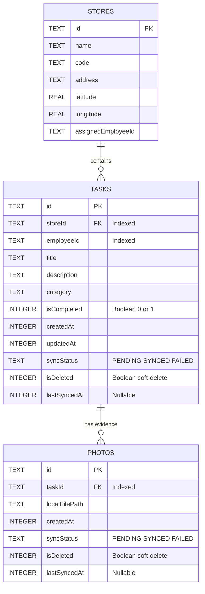
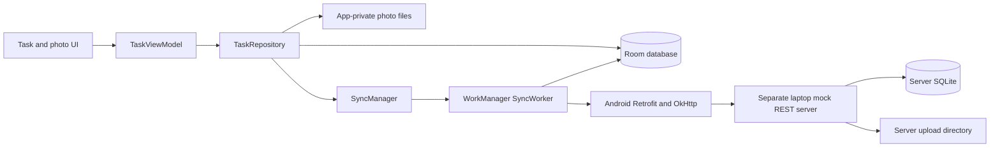
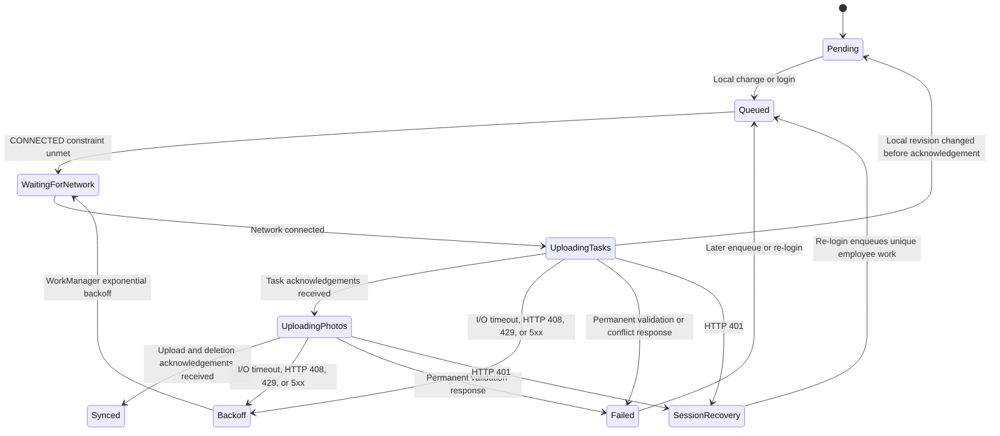

# StoreVisitManagement — Android Developer Bootcamp Week 4

## Project Overview
The **Store Visit Management System** is a robust Android application designed for field representatives to efficiently manage store visits, track merchandising, inventory, and audit tasks, capture photographic evidence, and operate seamlessly in offline environments. This project represents the core deliverable for **Android Developer Bootcamp Week 4**.

---

## Technology Stack
* **Language**: Kotlin 1.9+ / 2.0
* **UI Toolkit**: Android XML Layouts with ViewBinding & Material Design 3 Components
* **Architecture**: MVVM (Model-View-ViewModel) + Repository Pattern
* **Local Persistence**: Jetpack Room (SQLite) 2.8.5 with KSP
* **Networking**: Retrofit 2.11.0, OkHttp 4.12.0, Gson 2.11.0
* **Asynchronous Processing**: Kotlin Coroutines & Flow (Lifecycle-aware collection)
* **Background Sync**: WorkManager (`work-runtime-ktx` 2.9.1) with network-constrained unique work
* **Secure Session**: EncryptedSharedPreferences (`security-crypto` 1.1.0) with token expiry
* **Camera & File Handling**: AndroidX Camera Intent (`ActivityResultContracts.TakePicture`), FileProvider, `ExifInterface`

---

## Architecture
The application follows modern Android architectural guidelines:
* **UI Layer (`ui/`)**: Fragments and Activities observe lifecycle-aware StateFlow from ViewModels, ensuring zero memory leaks and robust state preservation across configuration changes.
* **Data Layer (`data/`)**: Repositories abstract data sources, coordinating between remote REST services (`ApiClient`) and local Room storage (`AppDatabase`).
* **Offline-First Design**: Assigned stores are cached locally in Room to allow offline dashboard navigation, while task CRUD and photo evidence management operate entirely offline.
* **File Management**: Captured images are downsampled to a maximum dimension of 1280px, compressed to JPEG at 80% quality on `Dispatchers.IO`, and stored in app-private internal storage (`filesDir/photos/`), with absolute paths referenced securely in Room.

---

## Day 15 Progress
* **Authentication**: Employee login and secure logout with in-memory session token management (`SessionManager`).
* **REST Integration**: Fully integrated with a standalone Node.js Mock REST Server.
* **Assigned Stores Dashboard**: Fetches and displays assigned stores with live search filtering by name, code, and address.
* **UI Theme**: Professional Premium Light Theme featuring off-white backgrounds (`#F8FAFC`), white cards, and royal-blue (`#2563EB`) / indigo (`#4F46E5`) accents.

---

## Day 16 Progress
* **Offline Task Management**: Create, edit, complete/reopen, filter, and delete tasks associated with specific assigned stores.
* **Room Persistence**: Full local persistence for stores, tasks, and photo references surviving app restarts.
* **Photo Evidence**: Camera capture, background compression, multiple photo attachments per task, thumbnail rendering, and fullscreen photo preview.
* **Validation & Polish**: Task title and description length validation, confirmation dialogs for deletions, and a polished enterprise task management UI.

---

## Database ER Diagram



### Explanation of Relationships
* **One-to-Many (`STORES` to `TASKS`)**: Each store contains multiple tasks linked via `storeId`. Deleting a store cascades deletion to its associated tasks (`ON DELETE CASCADE`).
* **One-to-Many (`TASKS` to `PHOTOS`)**: Each task has multiple photo evidence records linked via `taskId`. Deleting a task cascades deletion to its Room photo records (`ON DELETE CASCADE`).
* **Employee Ownership**: `TaskEntity` includes `employeeId` and `StoreEntity` includes `assignedEmployeeId` to enforce strict multi-employee data isolation.
* **Storage Strategy**: Relational metadata resides in Room SQLite, while compressed JPEG binaries reside in app-private internal storage (`filesDir/photos/`).

---

## Setup and Run Instructions
1. **Mock Server**: Navigate to the `mock-server/` directory, install dependencies (`npm install`), and start the mock server (`node server.js`).
2. **Android Studio**: Open the `StoreVisitManagement` project root in Android Studio (Arctic Fox or newer).
3. **ADB Reverse**: Connect your physical Android device or emulator, and execute:
   ```bash
   adb reverse tcp:8080 tcp:8080
   ```
4. **Run**: Build and run the `app` module on your device or emulator (`:app:assembleDebug`).

---

## Manual Testing Evidence

All manual test cases have been executed and confirmed by the developer on a physical Android device:

| Test Case | Status | Notes |
|---|---|---|
| Employee Login & Store Dashboard | **VERIFIED** | Successfully authenticates and loads assigned stores. |
| Store Live Search | **VERIFIED** | Filters assigned stores locally by name, code, and address. |
| Task Creation & Validation | **VERIFIED** | Rejects blank titles; creates valid tasks and saves to Room. |
| Task Editing & Completion | **VERIFIED** | Updates details and toggles task completion status seamlessly. |
| Filter Tabs (All / Pending / Completed) | **VERIFIED** | Dynamically filters task cards based on completion state. |
| Offline Task Creation | **VERIFIED** | Creates and saves tasks locally without internet or server connection. |
| Offline Camera Capture & Attachment | **VERIFIED** | Captures photos via camera intent and attaches to tasks offline. |
| Photo Thumbnail & Fullscreen Preview | **VERIFIED** | Displays 72dp thumbnails and opens full-size preview dialog. |
| Individual Photo Deletion | **VERIFIED** | Removes photo records and physical files with confirmation dialog. |
| App Close & Reopen Persistence | **VERIFIED** | Tasks and attached photos remain fully intact after closing and reopening the app. |
| Offline Access (Mock Server Stopped) | **VERIFIED** | Tasks and photos fully accessible with internet disabled and mock server stopped. |
| Process-Death Session Limitation | **LIMITATION** | Session token is held in-memory; true process death requires online reauthentication. |

---

## Bug Report and Resolution
* **Observed Issue**: Captured JPEG files existed in private storage and Room records were correctly linked, but photo thumbnails failed to render beneath tasks.
* **Root Cause**: RecyclerView ViewHolder binding relied on `findViewTreeLifecycleOwner()`, which could return `null` prior to view attachment, causing coroutine collection to abort.
* **Resolution**: Explicitly passed the Fragment's `viewLifecycleOwner` into `TaskListAdapter` and `PhotoAdapter`, implemented lifecycle-safe Flow collection (`repeatOnLifecycle`), added background bitmap decoding (`Dispatchers.IO`), and ensured recycling job cancellation (`loadJob?.cancel()`).
* **Verification**: User confirmed both photo thumbnails rendered successfully on the physical device.

---

## Independent Codex Review
* **Verdict**: **PASS WITH MINOR OBSERVATIONS**
* **Findings**: Critical: 0 | High: 0 | Medium: 3 | Low: 1
* **Known Limitations**:
  1. Failed physical file cleanup may leave an orphan JPEG in internal storage.
  2. A task completion database error may hide the task list temporarily.
  3. **Session Persistence**: Session tokens are held in-memory (`SessionManager`) as required for Day 16. If the operating system terminates the process completely, online reauthentication is required upon relaunch to obtain a new session token before accessing offline task storage. Offline authentication across true process death was not claimed or verified.
  4. Existing JVM tests have limited production-code coverage.

---

## Historical Build and Test Results
* **Gradle Build**: **SUCCESSFUL** (`:app:assembleDebug`).
* **Unit Tests**: **7 passed, 0 failed** (`TaskValidationTest` covering title/description validation, filtering, sync field defaults, dimension sampling, and canonical path validation).
* **Mock Server Tests**: **22 passed, 0 failed** (includes Day 17 sync, idempotency, and failure-retry coverage).
* **Git Diff Check**: Passed with zero whitespace errors.
* **APK Location**: `app/build/outputs/apk/debug/app-debug.apk`

---

## Day 17 — Offline Synchronization

### Objectives and implementation
Day 17 extends the offline task and photo workflow with background synchronization after connectivity returns.

- Room remains the source of truth for task and photo records. Local creates, edits, completion changes, and deletions remain available offline.
- SyncManager enqueues unique WorkManager work per employee with a CONNECTED network constraint. Login, app entry with a restored session, and local changes schedule work.
- SyncWorker sends task updates and tombstones before photo uploads. Photos upload only after their parent task has been acknowledged.
- Existing UUIDs remain stable across retries. Task acknowledgements are conditional on the sent updatedAt still matching the current Room row, so an edit made during upload stays pending.
- Encrypted session storage retains the employee, token, and expiry across process restart. A sync 401 clears the matching session but leaves Room records intact; successful re-login schedules sync again.
- This encrypted persistence supersedes the original in-memory session behavior noted in the historical Day 15/16 documentation.

### Offline synchronization architecture



### Room schema for synchronization

The non-destructive v1-to-v2 migration adds these columns to existing task and photo rows. It preserves the existing store, task, and photo data.

| Table | Day 17 synchronization fields | Identity and ownership |
|---|---|---|
| tasks | syncStatus (PENDING / SYNCED / FAILED), isDeleted, lastSyncedAt; updatedAt remains the task revision value | id is the stable client UUID; storeId and employeeId remain scoped |
| photos | syncStatus (PENDING / SYNCED / FAILED), isDeleted, lastSyncedAt | id is the stable client UUID; taskId links the parent task; localFilePath points to app-private storage |

Photo uploads are selected only for tasks that have synced. Tombstoned task rows remain local until the server acknowledges deletion; then Room removes the task and its child photo records.

### Day 17 acceptance criteria

- Offline task edits, completion changes, task/photo references, and photo files remain available in Room/app-private storage across process restart.
- WorkManager waits for connectivity, sends tasks before photos, and resumes eligible pending records after reconnection.
- Transient request failures retry with exponential backoff; retrying the same UUID does not create another server record.
- A newer local edit remains pending if an older upload is acknowledged; stale/conflicting server timestamps are rejected.
- Task and photo deletion tombstones are acknowledged without exposing deleted records to another employee.
- A 401 preserves pending Room data; re-login schedules sync for the active employee.

### Sync states and retry behavior



WorkManager uses the existing exponential backoff configuration (10-second initial delay). Network I/O failures and HTTP 408, 429, and 5xx responses retry. Permanent client errors remain marked FAILED rather than retrying indefinitely. Unexpected failures receive at most three bounded retries, then return failure while the Room data remains available.

### API flow, retries, and duplicate prevention

The Android client uses Retrofit/OkHttp. The laptop server is a separate Node.js/Express process with SQLite and persistent uploaded files.

| Request | Purpose |
|---|---|
| POST /api/v1/auth/login and /api/v1/auth/logout | Create and revoke the employee session |
| GET /api/v1/stores | Fetch stores assigned to the authenticated employee |
| POST /api/v1/tasks/sync | Create/update tasks or send task tombstones |
| POST /api/v1/photos/upload | Upload a photo after its parent task is synced |
| POST /api/v1/photos/delete | Send a photo tombstone; 404 is treated as already deleted |
| POST /api/v1/tasks/delete | Server task-delete route; the worker sends task tombstones through tasks/sync |

Example task request:

```json
{
  "tasks": [
    {
      "id": "9b1deb4d-3b7d-4bad-9bdd-2b0d7b3dcb6d",
      "store_id": "STR-001",
      "title": "Check Shelf Inventory",
      "description": "Aisle 3 check",
      "category": "INVENTORY",
      "is_completed": 0,
      "is_deleted": 0,
      "created_at": 1760000000000,
      "updated_at": 1760000000000
    }
  ]
}
```

The server uses the existing task/photo UUID as the SQLite primary key and photo filename basis. Replaying the same task payload or photo UUID acknowledges the existing record rather than creating another. A strictly newer updatedAt can replace server task state. An identical payload at the same timestamp is acknowledged; a stale or conflicting equal-timestamp payload receives HTTP 409. Local task acknowledgement updates Room only if the sent updatedAt still matches the current row.

Deleting a task sends is_deleted = 1. A SQLite trigger atomically tombstones its child server photo rows when the task tombstone is accepted. Individual photo deletion also sends a tombstone. Physical server image cleanup is not implemented in this milestone.

### Manual device evidence

The following evidence was collected manually before the final corrections:

- Created tasks and captured photos while offline; previewed photos offline.
- Confirmed pending data remained after force-stop and restart.
- Restored connectivity and observed automatic synchronization.
- Network Inspector showed HTTP 500 followed by HTTP 200. The error response was: “Simulated 500 server error for retry testing.” The failed request took 62 ms; the successful request took 39 ms.
- Checked the server SQLite database after the observed retry; no duplicate task was present.
- Edited a task offline and confirmed its UUID stayed the same.
- Deleted a task offline and confirmed is_deleted = 1.
- Restored synchronization after re-login.

These manual observations describe the tested runs and are not a substitute for unperformed tests listed under limitations.

### Debugging log

- An HTTP 404 came from an apparently outdated mock-server process. Restarting the server resolved it.
- Retry checks initially lacked the ADB reverse mapping. WorkManager backoff had also accumulated during repeated attempts.
- After restoring the mapping/connectivity and re-logging in, synchronization recovered.

### Independent review and corrections

The independent Codex review returned REVISION REQUIRED. It identified the Room string-default mismatch, missing child-photo tombstones on task deletion, equal-timestamp stale overwrite risk, and worker exceptions that could be silently reported as success. The implementation now quotes the Room text defaults to match MIGRATION_1_2, tests migration preservation, atomically tombstones server child photos, rejects stale/conflicting timestamps while accepting identical retries, and classifies retryable, permanent, and bounded unexpected worker errors.

No independent Codex re-review has been performed after these corrections.

### Latest verification

- Android debug build: successful.
- Android JVM unit tests: 10 passed, 0 failed, 0 skipped.
- Mock-server API tests: 26 passed, 0 failed, 0 skipped.
- Connected device instrumentation, including the targeted migration test: completed without reported failures. The Gradle tool did not provide an exact test count.
- git diff --check and git diff --cached --check: passed.

### Known limitations

- Immediate UI navigation after session expiry is deferred to Day 18.
- Physical server image cleanup is deferred.
- A separate Worker-level lost-acknowledgement test was not performed.
- The manual device evidence above was collected before the final corrections.
- The independent Codex review has not been repeated after the corrections.

### Project status and Day 18

Day 17 implementation and the listed verification are complete; the post-correction independent review remains outstanding. Day 18 focuses on debugging and monitoring: add clear sync diagnostics without logging tokens or credentials, verify session-expiry UI handling, and repeat retry/re-login scenarios on a device while observing WorkManager and network behavior.

---

## Day 18 — Debug Monitoring & Session Expiry Fix

### Objectives and Implementation
Day 18 addresses runtime monitoring, session expiry handling, and robust network failure recovery.

- **Session-Expiry Fix**: Resolved the defect where HTTP 401 responses left users stranded on protected task screens. `SessionManager` now exposes `isSessionValid` as a `StateFlow`, which `MainActivity` observes via lifecycle-aware collection (`repeatOnLifecycle`) to automatically navigate to Login and clear the protected back stack.
- **Network Failure & Recovery**: Verified offline task creation, automatic synchronization upon reconnection, HTTP 500 retry recovery, socket timeout handling (15s threshold), process termination persistence, and partial mid-sync interruption recovery.

### Manual Testing Evidence
- Task creation, editing, and completion: **PASS** (**VERIFIED**)
- All, Pending, and Completed filters: **PASS** (**VERIFIED**)
- Offline task creation & persistence: **PASS** (**VERIFIED**)
- Offline camera capture & photo attachment: **PASS** (**VERIFIED**)
- Photo thumbnail & fullscreen preview: **PASS** (**VERIFIED**)
- App close & reopen persistence: **PASS** (**VERIFIED**)
- Offline access (internet disabled & mock server stopped): **PASS** (**VERIFIED**)
- Network failure & recovery (ADB reverse toggle): **PASS** (**VERIFIED**)
- HTTP 500 failure & retry recovery: **PASS** (**VERIFIED**)
- Server timeout handling (15s threshold): **PASS** (**VERIFIED**)
- Session expiry automatic login redirection: **VERIFIED**
- Process kill & restart: **PASS** (**VERIFIED**)
- Mid-sync interruption: **PARTIAL**

### Independent Review & Verification
- **Gradle Build**: Successful (`:app:assembleDebug`).
- **Unit Tests**: 10 passed, 0 failed (`TaskValidationTest`).
- **Mock Server Tests**: Not rerun on Day 18. Day 17 recorded 26 passing API tests.
- **Git Diff Check**: Passed with zero whitespace errors.
- **Codex Verdict**: **PASS WITH MINOR OBSERVATION** (Note: only reported Day 18 observation is silently caught navigation exceptions).
- **Outstanding Monitoring Verification**: Actual in-flight interruption, automatic recovery after prolonged backoff, failed-state monitoring demonstration, and dashboard screenshot evidence.

## Daily Progress
* **Day 15**: Employee authentication, REST API integration, Assigned Stores Dashboard, and store search.
* **Day 16**: Offline task CRUD, Room persistence, camera capture, JPEG compression, photo evidence management, UI polish, and physical-device testing.
* **Day 17**: Offline-first WorkManager synchronization, persistent encrypted session, retry and recovery, server idempotency, timestamp conflict handling, and deletion tombstones.
* **Day 18**: Debug monitoring, session-expiry bug fix, comprehensive manual device testing, and final documentation completed.
* **Day 19 onward**: Not started.

---

## Remaining Submission Tasks
* Actual in-flight interruption and automatic recovery testing.
* Automatic recovery after prolonged backoff testing.
* Failed-state monitoring demonstration.
* Dashboard screenshot evidence.
* Final APK submission verification.
* Git commit and push (performed externally by user).
