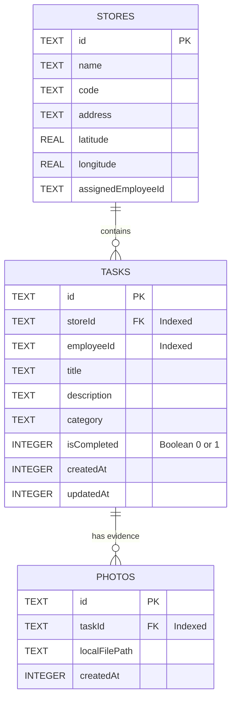

# StoreVisitManagement — Android Developer Bootcamp Week 4

## Project Overview
The **Store Visit Management System** is a robust Android application designed for field representatives to efficiently manage store visits, track merchandising, inventory, and audit tasks, capture photographic evidence, and operate seamlessly in offline environments. This project represents the core deliverable for **Android Developer Bootcamp Week 4**.

---

## Technology Stack
* **Language**: Kotlin 1.9+ / 2.0
* **UI Toolkit**: Android XML Layouts with ViewBinding & Material Design 3 Components
* **Architecture**: MVVM (Model-View-ViewModel) + Repository Pattern
* **Local Persistence**: Jetpack Room (SQLite) 2.8.5 with KSP
* **Networking**: Retrofit 2.11.0, OkHttp 4.12.0, Gson 2.11.0
* **Asynchronous Processing**: Kotlin Coroutines & Flow (Lifecycle-aware collection)
* **Camera & File Handling**: AndroidX Camera Intent (`ActivityResultContracts.TakePicture`), FileProvider, `ExifInterface`

---

## Architecture
The application follows modern Android architectural guidelines:
* **UI Layer (`ui/`)**: Fragments and Activities observe lifecycle-aware StateFlow from ViewModels, ensuring zero memory leaks and robust state preservation across configuration changes.
* **Data Layer (`data/`)**: Repositories abstract data sources, coordinating between remote REST services (`ApiClient`) and local Room storage (`AppDatabase`).
* **Offline-First Design**: Assigned stores are cached locally in Room to allow offline dashboard navigation, while task CRUD and photo evidence management operate entirely offline.
* **File Management**: Captured images are downsampled to a maximum dimension of 1280px, compressed to JPEG at 80% quality on `Dispatchers.IO`, and stored in app-private internal storage (`filesDir/photos/`), with absolute paths referenced securely in Room.

---

## Day 15 Progress
* **Authentication**: Employee login and secure logout with in-memory session token management (`SessionManager`).
* **REST Integration**: Fully integrated with a standalone Node.js Mock REST Server.
* **Assigned Stores Dashboard**: Fetches and displays assigned stores with live search filtering by name, code, and address.
* **UI Theme**: Professional Premium Light Theme featuring off-white backgrounds (`#F8FAFC`), white cards, and royal-blue (`#2563EB`) / indigo (`#4F46E5`) accents.

---

## Day 16 Progress
* **Offline Task Management**: Create, edit, complete/reopen, filter, and delete tasks associated with specific assigned stores.
* **Room Persistence**: Full local persistence for stores, tasks, and photo references surviving app restarts.
* **Photo Evidence**: Camera capture, background compression, multiple photo attachments per task, thumbnail rendering, and fullscreen photo preview.
* **Validation & Polish**: Task title and description length validation, confirmation dialogs for deletions, and a polished enterprise task management UI.

---

## Database ER Diagram



### Explanation of Relationships
* **One-to-Many (`STORES` to `TASKS`)**: Each store contains multiple tasks linked via `storeId`. Deleting a store cascades deletion to its associated tasks (`ON DELETE CASCADE`).
* **One-to-Many (`TASKS` to `PHOTOS`)**: Each task has multiple photo evidence records linked via `taskId`. Deleting a task cascades deletion to its Room photo records (`ON DELETE CASCADE`).
* **Employee Ownership**: `TaskEntity` includes `employeeId` and `StoreEntity` includes `assignedEmployeeId` to enforce strict multi-employee data isolation.
* **Storage Strategy**: Relational metadata resides in Room SQLite, while compressed JPEG binaries reside in app-private internal storage (`filesDir/photos/`).

---

## Setup and Run Instructions
1. **Mock Server**: Navigate to the `mock-server/` directory, install dependencies (`npm install`), and start the mock server (`node server.js`).
2. **Android Studio**: Open the `StoreVisitManagement` project root in Android Studio (Arctic Fox or newer).
3. **ADB Reverse**: Connect your physical Android device or emulator, and execute:
   ```bash
   adb reverse tcp:8080 tcp:8080
   ```
4. **Run**: Build and run the `app` module on your device or emulator (`:app:assembleDebug`).

---

## Manual Testing Evidence

All manual test cases have been executed and confirmed by the developer on a physical Android device:

| Test Case | Status | Notes |
|---|---|---|
| Employee Login & Store Dashboard | **VERIFIED** | Successfully authenticates and loads assigned stores. |
| Store Live Search | **VERIFIED** | Filters assigned stores locally by name, code, and address. |
| Task Creation & Validation | **VERIFIED** | Rejects blank titles; creates valid tasks and saves to Room. |
| Task Editing & Completion | **VERIFIED** | Updates details and toggles task completion status seamlessly. |
| Filter Tabs (All / Pending / Completed) | **VERIFIED** | Dynamically filters task cards based on completion state. |
| Offline Task Creation | **VERIFIED** | Creates and saves tasks locally without internet or server connection. |
| Offline Camera Capture & Attachment | **VERIFIED** | Captures photos via camera intent and attaches to tasks offline. |
| Photo Thumbnail & Fullscreen Preview | **VERIFIED** | Displays 72dp thumbnails and opens full-size preview dialog. |
| Individual Photo Deletion | **VERIFIED** | Removes photo records and physical files with confirmation dialog. |
| App Close & Reopen Persistence | **VERIFIED** | Tasks and attached photos remain fully intact after closing and reopening the app. |
| Offline Access (Mock Server Stopped) | **VERIFIED** | Tasks and photos fully accessible with internet disabled and mock server stopped. |
| Process-Death Session Limitation | **LIMITATION** | Session token is held in-memory; true process death requires online reauthentication. |

---

## Bug Report and Resolution
* **Observed Issue**: Captured JPEG files existed in private storage and Room records were correctly linked, but photo thumbnails failed to render beneath tasks.
* **Root Cause**: RecyclerView ViewHolder binding relied on `findViewTreeLifecycleOwner()`, which could return `null` prior to view attachment, causing coroutine collection to abort.
* **Resolution**: Explicitly passed the Fragment's `viewLifecycleOwner` into `TaskListAdapter` and `PhotoAdapter`, implemented lifecycle-safe Flow collection (`repeatOnLifecycle`), added background bitmap decoding (`Dispatchers.IO`), and ensured recycling job cancellation (`loadJob?.cancel()`).
* **Verification**: User confirmed both photo thumbnails rendered successfully on the physical device.

---

## Independent Codex Review
* **Verdict**: **PASS WITH MINOR OBSERVATIONS**
* **Findings**: Critical: 0 | High: 0 | Medium: 3 | Low: 1
* **Known Limitations**:
  1. Failed physical file cleanup may leave an orphan JPEG in internal storage.
  2. A task completion database error may hide the task list temporarily.
  3. **Session Persistence**: Session tokens are held in-memory (`SessionManager`) as required for Day 16. If the operating system terminates the process completely, online reauthentication is required upon relaunch to obtain a new session token before accessing offline task storage. Offline authentication across true process death was not claimed or verified.
  4. Existing JVM tests have limited production-code coverage.

---

## Build and Test Results
* **Gradle Build**: **SUCCESSFUL** (`:app:assembleDebug`).
* **Unit Tests**: **6 passed, 0 failed** (`TaskValidationTest` covering title/description validation, filtering, dimension sampling, and canonical path validation).
* **Git Diff Check**: Passed with zero whitespace errors.
* **APK Location**: `app/build/outputs/apk/debug/app-debug.apk`

---

## Daily Progress
* **Day 15**: Core employee authentication, REST API integration, Assigned Stores Dashboard, and store search implemented.
* **Day 16**: Offline task CRUD, Room persistence, camera capture, JPEG compression, photo evidence management, UI polish, bug resolution, physical-device testing, and final documentation completed.
* **Day 17 onward**: Not started.

---

## Remaining Submission Tasks
* Final APK submission verification.
* Git commit and push (performed externally by user).
